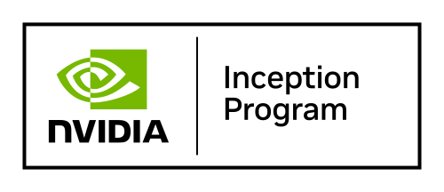

> **UI fork of [alam00000/bentopdf](https://github.com/alam00000/bentopdf)** for
> [pdf.taf.sh](https://pdf.taf.sh). AGPL-3.0-only.

<details>
<summary>Upstream BentoPDF sponsors</summary>

<h3 align="center">💖 Thank You to Our Sponsors</h3>
<p align="center"><sub>Organizational Supporters</sub></p>
<p align="center">
  <a href="https://vercel.com/open-source-program">
    
  </a>
  &nbsp;&nbsp;&nbsp;&nbsp;
  <a href="https://www.digitalocean.com/?refcode=d93c189ef6d0&utm_campaign=Referral_Invite&utm_medium=Referral_Program&utm_source=badge">
    
  </a>
  &nbsp;&nbsp;&nbsp;&nbsp;
  <a href="https://www.nvidia.com/en-us/startups/">
    
  </a>
  &nbsp;&nbsp;&nbsp;&nbsp;
  <a href="https://www.vultr.com/">
    <picture>
      <source media="(prefers-color-scheme: dark)" srcset="public/images/vultr-logo-dark.svg" />
      
    </picture>
  </a>
</p>
<p align="center"><sub>Individual Supporters</sub></p>
<p align="center"><!-- sponsors --><a href="https://github.com/gaedeke"></a><a href="https://github.com/stiflerbox"></a><a href="https://github.com/shollyethan"></a><a href="https://github.com/KnudH"></a><a href="https://github.com/mohannadhussain"></a><a href="https://github.com/chaoscastle"></a><a href="https://github.com/RobertGonzales1"></a><a href="https://github.com/michivonah"></a><a href="https://github.com/bmikaili"></a><a href="https://github.com/Thanyanit-J"></a><a href="https://github.com/AceofSpades5757"></a><a href="https://github.com/Jacco011"></a><a href="https://github.com/Pallandos"></a><a href="https://github.com/haritvsmurali"></a><a href="https://github.com/mrtoadie"></a><a href="https://github.com/sam12dr21"></a><a href="https://github.com/BGauthier2020"></a><!-- sponsors --></p>
<p align="center">
  <a href="https://github.com/sponsors/alam00000"></a>
  <a href="https://ko-fi.com/alio01"></a>
</p>

</details>

# BentoPDF (TanStack UI)

Client-side PDF toolkit on **TanStack Start + beUI + reicon**. Every catalog
tool runs a real in-browser processor (pdf-lib / pdf.js) — no iframes.

## Quick start

```bash
bun install
bun run dev
```

→ **http://127.0.0.1:3000**

```bash
cd web && bun install && bun run dev
```

## Stack

| Layer | Tech |
|-------|------|
| App | TanStack Start (Vite + Router + Nitro) |
| UI | Tailwind v4, beUI, reicon |
| PDF | pdf-lib, pdfjs-dist, jszip |

## Tools

- **PDF Multi Tool** — full page organizer UI
- **Merge PDF** — dedicated merge UI
- **All other catalog tools** — shared `ToolWorkspace` + processors

## Scripts

| Command | Purpose |
|---------|---------|
| `bun run dev` | TanStack app on :3000 |
| `bun run build` | Production build |
| `bun run html:dev` | Optional legacy HTML app on :5173 |
| `npm run seo-audit` | Audit every route on the built production server |

Build with `bun run build` before running the SEO audit. The audit needs the
root dependencies and `web/` dependencies installed. It starts and stops its
own Nitro server, checks the home page and every catalog tool, and verifies
canonicals, descriptions, social images, internal links, sitemap, robots.txt,
and missing-page responses.

Set `VITE_SITE_URL` at build time for a different public origin. It defaults
to `https://pdf.taf.sh`. Use the same value when running the audit.
`npm run seo-audit:legacy` retains the old audit for optional root Vite builds.

## License

AGPL-3.0-only.
